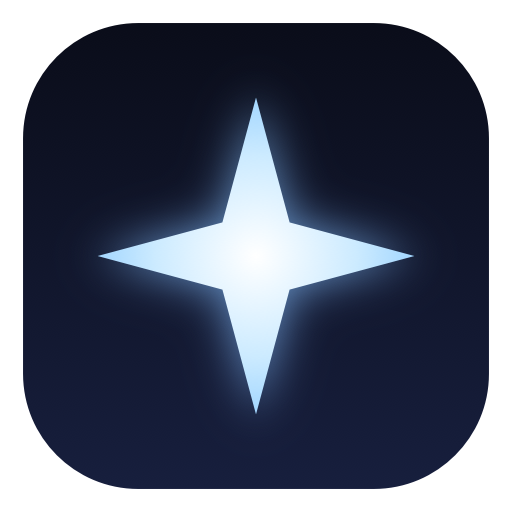

<p align="center">
  
</p>

<h1 align="center">Pulsar</h1>

<p align="center">
  A tiling window manager for macOS.
</p>

<p align="center">
  
  
  
  
</p>

---

## Similar to Hyprland

If you have used [Hyprland](https://hyprland.org) on Linux, the model will be familiar.

| | Hyprland | Pulsar |
|---|---|---|
| Platform | Linux, Wayland | macOS, Accessibility APIs |
| Tiling | dynamic, dwindle or master | split for two windows, grid for three or more |
| Workspaces | numbered, per monitor | `1`–`9` and `a`–`z`, single display |
| Focus | `Super` + `h j k l` | `alt` + `h j k l` |
| Directional move | `Super` + `Shift` + arrows | `alt` + `Shift` + `h j k l` |
| Resize | `Super` + right-drag, or binds | `alt` + `-` / `alt` + `=` |
| Config file | `hyprland.conf` | none — keys are fixed |
| Gaps and borders | configurable | none, panes sit edge to edge |

The differences come from the platform: windows keep their native title bars and traffic lights,
and the whole application is one small menu-bar agent rather than a compositor.

## Requirements

- macOS 13 or later on Apple silicon
- Accessibility permission, granted once
- No dependencies — no package manager step, no third-party libraries

## Install

Download **`Pulsar.dmg`** from [Releases](https://github.com/Wizard242008/pulsar/releases), open it,
and drag **Pulsar** into **Applications**.

Launch it once from Applications. After that it starts at login through
`~/Library/LaunchAgents/com.devansh.pulsar.plist`.

> The app is signed with a self-signed certificate rather than notarised by Apple. On first launch
> macOS may say it cannot verify the developer: right-click the app and choose **Open** once, or run
> `xattr -dr com.apple.quarantine /Applications/Pulsar.app`.

<details>
<summary>Build from source</summary>

```bash
git clone https://github.com/Wizard242008/pulsar.git
cd pulsar
./build.sh
```

`build.sh` compiles with `swiftc`, draws the icon, writes `build/Pulsar.dmg`, signs the bundle,
installs it to `/Applications` and restarts it.

</details>

## Permission

On first launch macOS asks for Accessibility. If the prompt was dismissed:

1. Open **System Settings → Privacy & Security → Accessibility**
2. Enable **Pulsar** — use **+** and pick `/Applications/Pulsar.app` if it is not listed

Until it is granted the app cannot read or move windows, so nothing will happen. The menu shows
*Accessibility permission needed* in that state, and **Grant Accessibility…** opens the right pane.

## Keys

| Keys | Action |
|---|---|
| `alt` + `h` `j` `k` `l` | focus left / down / up / right |
| `alt` + `Shift` + `h` `j` `k` `l` | move the focused window |
| `alt` + `-` / `alt` + `=` | shrink / grow the focused window |
| `alt` + `/` | toggle horizontal / vertical split |
| `alt` + `1`…`9` | switch to workspace 1–9 |
| `alt` + `Shift` + `1`…`9` | send the focused window to that workspace |
| `alt` + `a`…`z` (except `h j k l`) | switch to that lettered workspace |
| `alt` + `Shift` + letter | send the focused window to that workspace |

The menu's **Hotkeys** submenu lists every binding and follows the modifier chosen in Settings. Its
items also work when clicked, so the menu and the keyboard stay in step.

Clicking an app in the Dock, or reaching it with Cmd-Tab, jumps to the workspace that holds its
window.

## Settings

**Settings…** in the menu (`⌘,`) covers what is configurable:

| Setting | Effect |
|---|---|
| Follow an app to its workspace | clicking an app jumps to the workspace holding its window |
| Focus follows mouse | hovering focuses a window, and entering a workspace focuses the pane under the pointer |
| Restore my layout at launch | windows return to their workspaces on launch; off means everything starts on one |
| Modifier for all shortcuts | moves the whole scheme from `alt` to `control` or `command`, applied immediately; the Hotkeys menu updates to match |
| Check for Updates | runs an update check on demand |
| Show Log | opens `~/Library/Logs/Pulsar.log` |

## Behaviour

- **One window fills the screen, two split it, three or more form a grid.** Built for a handful of
  windows per workspace.
- **Apps' minimum sizes are respected.** macOS offers no way to ask for a window's minimum, so it is
  measured: a window that refuses a size keeps it, that size is recorded for the app, and the layout
  allocates around it. If the minimums cannot all fit, panes run past the screen edge rather than
  overlapping.
- **A size you set stays set.** Dragging a divider is folded back into the layout ratio and saved
  per window, so it survives refreshes and restarts.
- **Full-screen windows are left alone.** A window reporting `AXFullScreen` is removed from
  management entirely — never tiled, never hidden.
- **Placement survives restarts.** Windows are remembered by app bundle id plus window title, with a
  per-app fallback when the title has changed.
- **Quitting gives your windows back.** Every hidden window is moved onto the visible screen when
  Pulsar exits, each sized to the full frame so it looks the way it did on its own workspace. They
  return to their workspaces next launch, because placement is saved first.

## Workspaces

Workspaces are `1`–`9` and `a`–`z`, excluding `h`, `j`, `k`, `l` because those focus windows.

Windows on other workspaces are moved to the bottom-left corner of the screen, one pixel past the
edges, where they cannot be seen or clicked. Switching back moves them into place.

The current workspace, the layout direction, each window's size and its workspace are stored in
`~/Library/Preferences/com.devansh.pulsar.plist`.

## Updates

Pulsar checks GitHub Releases once a day in the background; **Check for Updates…** checks on demand.

**Install Update** downloads the DMG, replaces the app in `/Applications`, clears the quarantine
flag and relaunches. **Release Notes** opens the GitHub page instead. Accessibility permission is
kept across updates, because the bundle identifier and signing certificate do not change.

## Troubleshooting

The log is at `~/Library/Logs/Pulsar.log`. The line that explains most problems:

```
pulsar: refresh ws=b tracked=5 onScreen=5 trusted=true
```

`trusted=false` means the Accessibility permission is missing or was reset.

`build/wmpeek` reports what the window server actually did, without needing any permission:

```bash
./build/wmpeek --check     # overlap count, pane positions, total span
./build/wmpeek --parked    # windows hidden on other workspaces
```

Ask the running app to re-tile, or to dump its own view of every window:

```bash
notifyutil -p com.devansh.pulsar.retile
notifyutil -p com.devansh.pulsar.dump     # then read the log
```

If permission seems to reset after a rebuild, that is signing: an ad-hoc signature's identity is the
binary hash, so a new build looks like a new app. `build.sh` signs with a certificate, which keeps
the grant.

## Building

`swift build` does not work on this machine — CommandLineTools has a broken XCBuild — so `build.sh`
calls `swiftc` directly:

```bash
swiftc -O -swift-version 5 -target arm64-apple-macos13.0 Sources/Pulsar/*.swift -o build/Pulsar
```

| File | Purpose |
|---|---|
| `Sources/Pulsar/main.swift` | entry point, `--diagnose`, `--render-glyph`, `--render-help` |
| `Sources/Pulsar/Controller.swift` | discovery, layout application, workspaces, focus |
| `Sources/Pulsar/Persistence.swift` | window identity, placement, sizes, quit behaviour |
| `Sources/Pulsar/Layout.swift` | pure geometry — splits, grid, minimum-size allocation |
| `Sources/Pulsar/AX.swift` | Accessibility wrappers |
| `Sources/Pulsar/Model.swift` | `Win`, `Orientation`, `Store` |
| `Sources/Pulsar/Hotkeys.swift` | Carbon hotkey registration |
| `Sources/Pulsar/UI.swift` | menu-bar item, menu, About |
| `Sources/Pulsar/Settings.swift` | Settings and Help windows |
| `Sources/Pulsar/Update.swift` | release check and install |
| `Sources/Pulsar/Debug.swift` | development hooks driven by `notifyutil` |
| `Tools/makeicon` | draws the app icon at every iconset size |
| `Tools/wmpeek` | reads window geometry without Accessibility |

## License

MIT — see [LICENSE](LICENSE).
